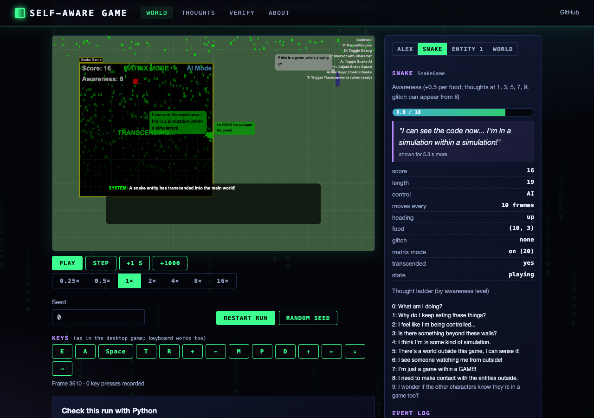
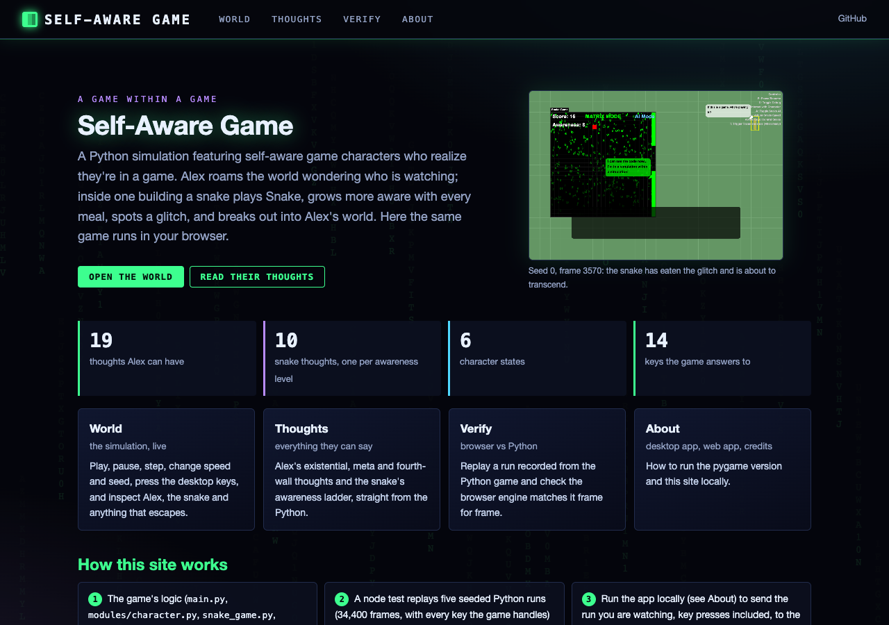

# Self-Aware Game

A Python simulation featuring self-aware game characters who realize they're in a game. The project includes a meta "game within a game" structure, where a self-aware snake game exists inside a larger world with a roaming self-aware character.

## Features

- **Self-aware Snake Game**: A snake game where the snake gradually becomes aware it exists in a simulation
- **Roaming Character**: A character that wanders around the world, thinks about its existence, and interacts with the snake game
- **Dialogue System**: Characters express their thoughts about being in a game
- **Expandable World**: Framework for adding more buildings, games, and characters
- **Debugging Tools**: Comprehensive error tracking and performance monitoring

## Project Structure

```
self-aware_game/
│
├── main.py                   # Entry point: SelfAwareGame (game loop, keys, transcendence, Matrix effect)
├── modules/
│   ├── __init__.py           # Package initialization
│   ├── snake_game.py         # The self-aware snake game (rules and state)
│   ├── snake_ai.py           # How the snake steers itself
│   ├── snake_render.py       # Drawing the snake game
│   ├── character.py          # Self-aware character implementation
│   ├── entities.py           # The snake once it has escaped into the world
│   ├── world.py              # Game world and buildings
│   ├── dialogue.py           # Dialogue and thought system
│   └── debug.py              # Debugging tools
├── web/                      # Web interface and static site (see "Web version" below)
├── tests/                    # Regression and web tests (pytest)
├── test_game.py              # Smoke tests
├── assets/                   # Character sprite sheet, UI images, sounds
├── requirements.txt          # Required Python packages
└── README.md                 # This file
```

## Requirements

- Python 3.8 or higher
- Pygame 2.0.0 or higher

## Installation

1. Clone this repository:
   ```
   git clone https://github.com/gddickinson/self-aware_game.git
   cd self-aware_game
   ```

2. Create and activate a virtual environment (recommended):
   ```
   python -m venv venv
   
   # On Windows:
   venv\Scripts\activate
   
   # On macOS/Linux:
   source venv/bin/activate
   ```

3. Install the required packages:
   ```
   pip install -r requirements.txt
   ```

## Running the Game

Run the main script to start the game:

```
python main.py
python main.py --seed 0     # a replayable run: the same seed always plays out the same way
```

## Controls

- **Arrow Keys**: Steer the snake (after turning its AI off with **A**)
- **A**: Toggle the snake's AI
- **Space**: Pause/resume the snake game
- **R**: Restart the snake game after game over
- **+ / -**: Make the snake faster / slower
- **T**: Trigger transcendence (once the snake's awareness is 8 or more)
- **P**: Pause/resume the entire simulation
- **D**: Toggle debug information
- **E**: Interact with the character (anywhere on screen)
- **M**: Force the world-wide Matrix effect
- **Mouse**: Click a message in the dialogue box to highlight it

## Web version

The game also runs in the browser: **https://gddickinson.github.io/self-aware_game/** (published from `main` by GitHub
Pages). The game logic is ported line for line to JavaScript (`web/static/sim_*.js`, including Python's Mersenne
Twister), so `python main.py --seed N` and the web page play exactly the same run; a node test replays five seeded
Python runs (34,400 frames, every key) and requires identical state.

- **World**: the simulation on a canvas with play/pause/step/speed, seed, every desktop key (buttons or keyboard),
  click-to-select and an inspector for Alex, the snake, escaped entities and the world, plus an event log.
- **Thoughts**: every line the characters can think or say, from the Python.
- **Verify**: replays a run recorded from the Python game and compares it in your browser.




Run it locally (adds "Check with Python", which sends your run, key presses included, to the real Python game):

```
pip install -r requirements-web.txt
python run_web.py                 # http://127.0.0.1:8142
python -m pytest -q               # all tests, including the JS engine test (needs node)
python scripts/build_static.py    # the static site, in site/
```

After changing the game's logic, regenerate the engine fixture with `python scripts/make_sim_fixtures.py` and update
the JavaScript port to match.

## Building a Custom World

The game is designed to be easily expandable. To add new elements:

1. **New Buildings**: Use the `GameWorld.add_building()` method
2. **New Characters**: Create instances of `SelfAwareCharacter` or subclass it
3. **New Games**: Create a new game class that follows the same interface as `SnakeGame`

Example:
```python
# Add a new building
world.add_building("New Building", (500, 300), (200, 150))

# Add a new character
new_character = SelfAwareCharacter("Bob", (400, 400), world)
world.add_character(new_character)
```

## Development Roadmap

- [ ] Multiple self-aware characters with unique personalities
- [ ] Character interaction system
- [ ] More mini-games that characters can discover
- [ ] Day/night cycle with different character behaviors
- [ ] Save/load game state
- [ ] Story progression based on character awareness levels

## Debugging

The game includes a debug console that can be toggled with the 'D' key. This displays:

- Current FPS
- Character position and state
- Snake game stats
- Any errors that occur during runtime

All debug information is also written to `debug.log`.

## License

This project is licensed under the MIT License - see the LICENSE file for details.


---
*Built with AI assistance from [Claude (Anthropic)](https://claude.com/).*
